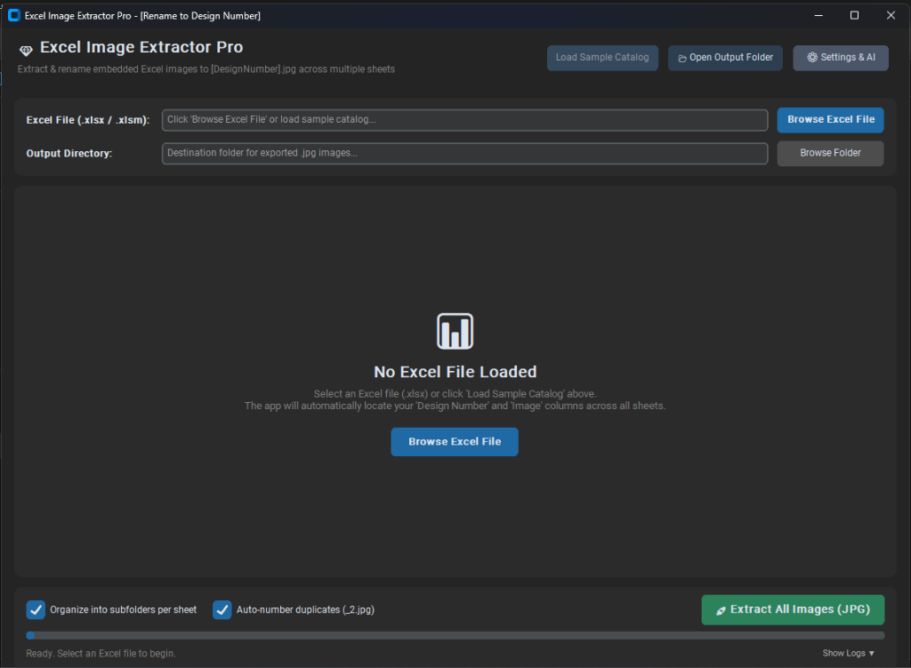
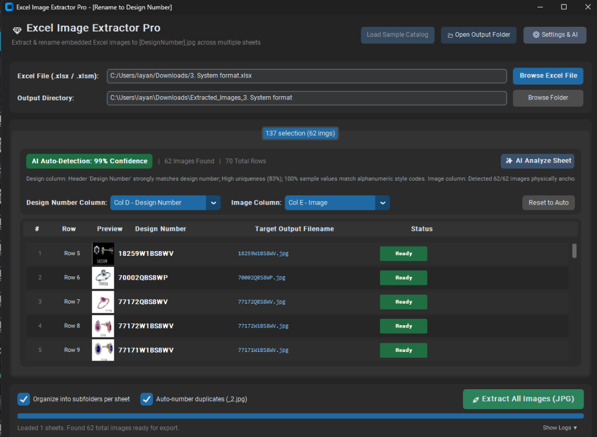
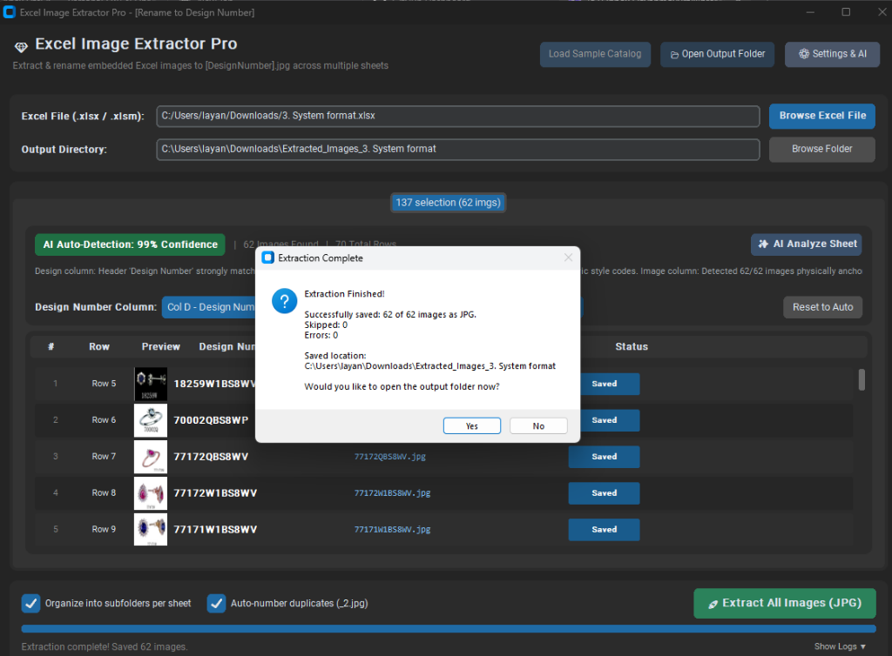

# 💎 Excel Image Extractor Pro (Powered by AI)

[](https://www.python.org/downloads/)
[](https://microsoft.com/windows)
[](https://github.com/layanmoyura/excel_image_extractor_powered_by_ai/releases)
[](LICENSE)

A modern, high-performance Windows desktop application designed to automatically extract embedded pictures from Excel spreadsheets (`.xlsx`, `.xlsm`) and save them as high-quality `.jpg` images automatically named after their corresponding **Design Number** / SKU (e.g., `18259W1BS8WV.jpg`).

---

## 📥 Download Latest Release

You can download the pre-built, ready-to-use Windows application from GitHub Releases without needing Python installed:

👉 **[Download Latest Release (Windows x64)](https://github.com/layanmoyura/excel_image_extractor_powered_by_ai/releases/latest)**

---

## 📸 User Interface & Screenshots

### 1. Modern Dashboard & Workbook Selection
Clean, modern dark-themed interface with drag-and-drop or one-click browsing for Excel files, as well as a preloaded sample catalog:


---

### 2. AI Auto-Detection & Live Image Preview
Built-in heuristic AI scans rows and statistical data patterns to auto-detect Design Number and Image columns with confidence indicators, paired with a real-time thumbnail table:


---

### 3. Instant Multithreaded Extraction
Extracts, composites transparency onto pure white backgrounds, numbers duplicates, and notifies you upon completion with direct 1-click access to the export folder:


---

## 🌟 Key Features

1. **Any Column Placement**:
   - The **Design Number** and **Image** columns can be located anywhere in any worksheet.
   - Built-in heuristic AI scans rows 1–15 to locate candidate headers and inspects cell data patterns to automatically detect the exact columns.

2. **Multi-Sheet Support**:
   - Seamlessly processes workbooks with multiple worksheets (e.g., *Rings & Earrings*, *Pendants*, *Custom Orders*).
   - Each sheet gets its own tab view with independent column mappings and image counts.
   - Option to organize exports into subfolders per sheet or export all into a single unified directory.

3. **Smart AI & Column Detection**:
   - **Local Smart AI (Offline & Instant)**: Uses statistical pattern recognition (alphanumeric jewelry codes, uniqueness ratio, keyword semantic scoring, image anchor density) to achieve >95% auto-detection accuracy with 0ms latency.
   - **Cloud LLM Integration (Google Gemini & OpenAI)**: Optional API integration for exotic or unheadered spreadsheets.
   - **Manual Dropdown Override**: Easily override column mappings with 1 click from an intuitive dropdown list.

4. **High-Quality JPG Conversion**:
   - Extracts embedded PNG, WEBP, BMP, or TIFF images.
   - Corrects transparency: Transparent jewelry images (PNG) are automatically composited onto a clean, solid white background rather than appearing with black background artifacts.
   - Configurable JPEG quality (default 95%).

5. **Duplicate Handling**:
   - When multiple images share the same design number, the app automatically numbers them (e.g., `18259W1BS8WV.jpg`, `18259W1BS8WV_2.jpg`), or can overwrite/skip based on your preferences.

6. **Live Visual Preview Table**:
   - Shows image thumbnails, row numbers, design numbers, proposed filenames, and status indicators before exporting.

7. **Thread-Safe & Responsive**:
   - Background multi-threading ensures the application never freezes or lags during large catalog exports.

---

## 🚀 Quick Start & How to Run

### Method 1: Pre-built Executable (Recommended)
1. Download `ExcelImageExtractorPro-v1.0.0-windows-x64.zip` from [Releases](https://github.com/layanmoyura/excel_image_extractor_powered_by_ai/releases/latest).
2. Extract the ZIP file and run `ExcelImageExtractorPro.exe`.

### Method 2: Run from Source
```powershell
# Clone the repository
git clone https://github.com/layanmoyura/excel_image_extractor_powered_by_ai.git
cd excel_image_extractor_powered_by_ai

# Install dependencies
pip install -r requirements.txt

# Launch the app
python app.py
```
Or double-click `run.bat` (shows console) or `run_silent.vbs` (silent background execution).

---

## 📖 How to Use the App

1. **Step 1: Choose Your Excel File**
   - Click **"Browse Excel File"** and select your `.xlsx` or `.xlsm` file.
   - *(Optional)* Click **"Load Sample Catalog"** in the top bar to test the application with a pre-configured 65-image jewelry catalog!

2. **Step 2: Review Auto-Detected Columns**
   - The app automatically scans all sheets and displays tabs for each sheet.
   - View the detected **Design Number Column** and **Image Column** along with confidence score and reasoning.
   - If needed, adjust the columns using the dropdown menus.
   - Click **"✨ AI Analyze Sheet"** to run AI-assisted structural analysis.

3. **Step 3: Choose Output Destination & Options**
   - Select the target output folder (defaults to `Extracted_Images_<WorkbookName>` next to your Excel file).
   - Choose whether to:
     - `[x] Organize into subfolders per sheet`
     - `[x] Auto-number duplicates (_2.jpg)`

4. **Step 4: Extract Images**
   - Click the green **"🚀 Extract All Images (JPG)"** button.
   - Watch real-time progress on the progress bar.
   - Once complete, click **"Yes"** to immediately open the exported folder in Windows Explorer!

---

## ⚙️ Configuration & Settings

Click the **⚙ Settings & AI** button in the header to configure:
- **AI Engine**: Choose between **Local Smart AI** (default, offline), **Google Gemini**, or **OpenAI**.
- **API Key**: Enter your Gemini or OpenAI API key.
- **Model**: Select model (e.g. `gemini-1.5-flash`, `gpt-4o-mini`).
- **JPEG Quality**: Adjust slider between 70% and 100% (default: 95%).
- **Theme**: Dark, Light, or System appearance mode.

---

## 📂 Project Structure

```
excel_image_extractor_powered_by_ai/
├── assets/
│   └── screenshots/          # Application screenshots for documentation
├── core/
│   ├── excel_engine.py       # Dual extraction engine (openpyxl + direct ZIP/XML fallback)
│   ├── column_detector.py    # Statistical heuristic scorer & column auto-detector
│   ├── image_saver.py        # Safe Windows filename sanitizer & JPG converter
│   └── ai_assistant.py       # Cloud LLM & local AI integration
├── ui/
│   ├── app_window.py         # Main CustomTkinter desktop interface
│   ├── sheet_view.py         # Per-sheet mapping & thumbnail preview table
│   └── settings_modal.py     # Settings dialog for AI keys & preferences
├── app.py                    # Main application entry point
├── generate_sample_excel.py  # Script that generated Jewelry_Catalog_Sample.xlsx
├── Jewelry_Catalog_Sample.xlsx # Realistic 65-item test catalog
├── run.bat                   # Double-click launcher
├── run_silent.vbs             # Silent Windows launcher
├── build_exe.bat             # PyInstaller build script
└── requirements.txt          # Python dependencies
```

---

## 🛠️ Building from Source

To build your own standalone Windows `.exe`:
```powershell
.\build_exe.bat
```
The output will be placed in `dist\ExcelImageExtractorPro\ExcelImageExtractorPro.exe`.

---

## 📄 License

This project is licensed under the MIT License - see the [LICENSE](LICENSE) file for details.
